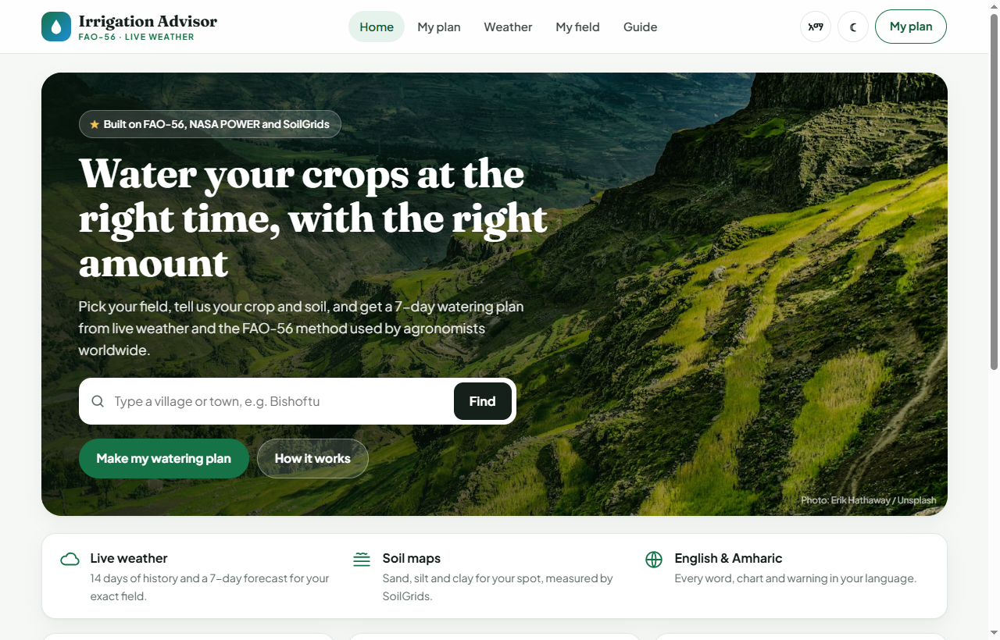
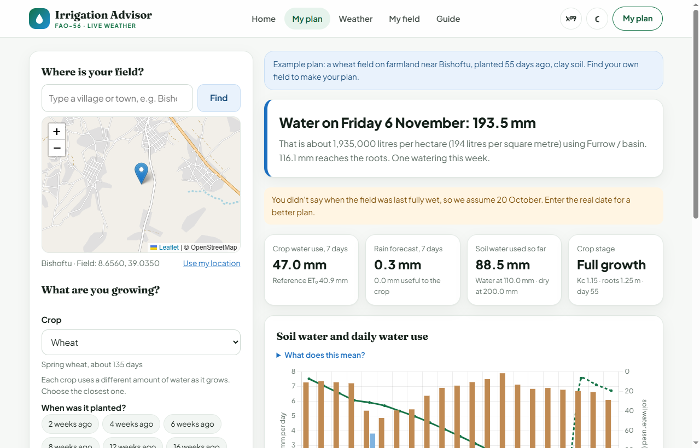
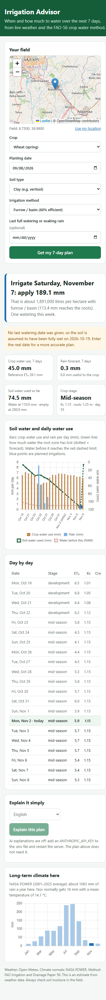
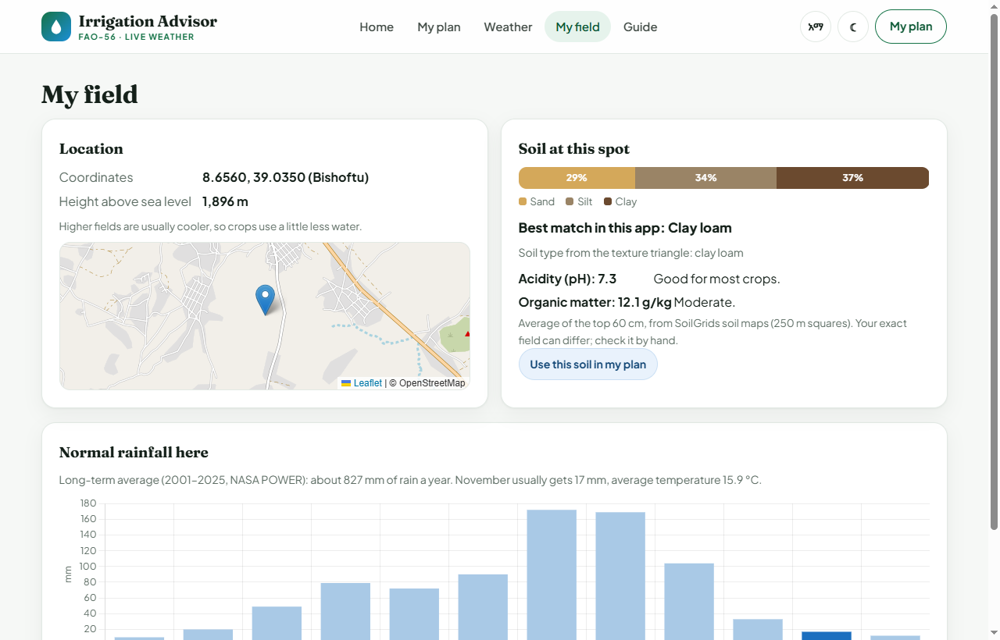

# Irrigation Advisor: when and how much to water, from live weather

Irrigation Advisor tells a farmer or extension officer **when to irrigate over the next 7 days and how much water to apply**. You find the field by typing a village name or tapping the map, then enter the crop, planting date, soil and irrigation method. The app downloads real weather for that spot, reads world soil maps to suggest the soil type, runs the FAO-56 crop water method day by day, and turns the result into a plan. The whole interface is available in **English and Amharic**, in light and dark themes, with a plain-language explanation under every question.

**Live:** https://irrigation-advisor.vercel.app

It is a working prototype built in Python (Flask) with a plain JavaScript front end.

<p>
  
</p>
<p>
  
  
</p>
<p>
  
</p>

---

## Quick start

```bash
python -m venv .venv
.venv\Scripts\activate            # macOS/Linux: source .venv/bin/activate
pip install -r requirements.txt
copy .env.example .env            # macOS/Linux: cp .env.example .env  (optional, for AI)
python run.py                     # http://127.0.0.1:5000
python -m pytest                  # 78 tests
```

The weather and climate sources are free and need no keys. Without an `ANTHROPIC_API_KEY` the app still calculates every plan; only the "Explain it simply" button is turned off, and the page says why.

---

## What you get

Five sections, reachable from the top menu:

- **Home:** what the app does, the three steps, and today's advice for the example field.
- **My plan:** the form and the plan. The field can be found by **typing a village or town** (Open-Meteo geocoding) or tapping the map; planting date has quick choices such as "8 weeks ago"; soil has a **"Not sure? Suggest from soil maps"** button; every question has a plain explanation.
- **Season & pond:** the water the crop needs **every day from planting to harvest** (planting can be a future date), totals for the field in mm, litres and m³, a month-by-month table, and the **storage pond to dig**: how much it must hold including evaporation and seepage losses (lined or unlined), with top, bottom and depth dimensions and a cross-section drawing.
- **Weather:** the next 7 days as cards (temperature, rain and its chance, wind, crop thirst, watering days marked) and the last 14 days as a chart.
- **My field:** soil at the exact spot from **SoilGrids** (sand, silt and clay %, USDA texture class, pH, organic carbon, black cotton soil warning), elevation, and long-term rainfall from NASA POWER.
- **Guide:** how the plan is calculated, how to identify soil by hand (the ribbon test), which watering method is which, what "mm of water" means, and every term used.

Language (English or Amharic) and theme (light or dark) are switched from the header and remembered on the device. The first visit opens with a real example plan for a wheat field near Bishoftu, so every page has content straight away.

In the plan itself:

- **A headline answer:** for example "Irrigate Saturday, 7 November: apply 189 mm", with the litres per hectare and how much of it reaches the roots.
- **This week at a glance:** crop water use, forecast rain and how much of it is useful, how much soil water has already been used, crop stage, Kc and root depth.
- **A soil water chart:** daily crop water use and rain as bars, the root-zone water deficit as a line (solid for the past 14 days, dotted for the forecast), the limit where the crop starts to suffer, and the planned irrigations.
- **A day-by-day table** covering 14 days of history and 7 days of forecast.
- **Long-term climate for the spot:** monthly rainfall and temperature normals from NASA POWER, with the current month highlighted.
- **Plain-language advice from AI** in English, Amharic or Afaan Oromo, covering what to do this week, why, practical tips for the crop, soil and method, and how to check soil moisture by hand.
- **Clear warnings:** if the starting soil state had to be assumed, if the crop was probably stressed recently, or if the climate service is down.

Crops: wheat, teff, maize, tomato, onion and coffee. Soils: sand, sandy loam, loam, clay loam and clay (vertisols). Methods: furrow or basin, sprinkler and drip.

---

## How the calculation works

All formulas and crop and soil values come from **FAO Irrigation and Drainage Paper No. 56** (Allen et al., 1998). The tables are in [app/crops.py](app/crops.py), with the FAO-56 table number next to each value, and the method is in [app/fao56.py](app/fao56.py).

1. **Reference evapotranspiration (ET₀).** This is how much water a reference grass would use each day. It comes from Open-Meteo (`et0_fao_evapotranspiration`), which calculates it with the FAO-56 Penman-Monteith equation from temperature, humidity, wind and radiation.
2. **Crop water use, ETc = Kc × ET₀.** The crop coefficient Kc follows the FAO-56 curve. It is flat in the initial stage, rises during development, is flat in mid-season and falls in the late season. The stage lengths start from the planting date. Coffee is treated as a mature perennial.
3. **Root zone.** Roots grow from 0.2 m at planting to the crop's maximum depth by mid-season. Total available water is TAW = (water held per metre of soil) × root depth. The crop can use the readily available water, RAW = p × TAW, before it is stressed.
4. **Effective rain.** Rain under 2 mm in a day is ignored, since it mostly evaporates. 80% of heavier rain counts towards the root zone.
5. **Daily water balance (FAO-56 eq. 85).** Each day, the deficit goes up by the crop's water use and down by the effective rain. It can't fall below zero, because extra water drains away. The balance starts with the soil full on the last full watering date. For past days the crop slows down once it runs short of water (stress coefficient Ks, eq. 84).
6. **Schedule.** For today and the next six days, when the deficit passes RAW the plan says to irrigate and refill the root zone. The net depth is the deficit. The depth to apply is the net depth divided by the efficiency of the method (furrow 60%, sprinkler 75%, drip 90%). 1 mm over one hectare is 10,000 litres.

**The AI only explains.** The server keeps each calculated plan for an hour and sends exactly that plan to Claude (`claude-opus-5-5` through the Anthropic Python SDK). The instructions say to use only the numbers in the plan and never invent new ones. If the model declines a request, the API retries it on Anthropic's recommended fallback model, and if it still declines, the page says so instead of showing anything.

---

## Project layout

| Path | What it does |
|---|---|
| `app/crops.py` | Crop, soil and irrigation-method tables, with FAO-56 sources |
| `app/fao56.py` | Growth stages, Kc, roots, effective rain, stress and the daily water balance |
| `app/weather.py` | Open-Meteo forecast and history, NASA POWER climate normals, friendly errors |
| `app/season.py` | Whole-season budget: monthly Penman-Monteith ET₀ from NASA POWER averages, daily crop need to harvest, useful rain, storage pond size |
| `app/site.py` | SoilGrids soil texture (0-60 cm average), USDA texture triangle, soil suggestion, elevation |
| `app/plan.py` | Input checks, the starting soil state, the 7-day plan and its summary and warnings |
| `app/advisor.py` | AI explanation through the Anthropic SDK, with error and refusal handling |
| `app/__init__.py` | Flask routes: `/api/options`, `/api/plan`, `/api/season`, `/api/site`, `/api/explain` |
| `public/` | The site: five sections, Leaflet maps, Chart.js charts, plain JavaScript and CSS (served by Vercel's CDN, or by Flask locally) |
| `public/static/i18n.js` | Every visible string in English and Amharic |
| `tests/` | pytest suites; every external service is mocked |

---

## Tests

```bash
python -m pytest
```

There are 78 tests covering:
- the Kc curve, root growth, effective rain, the stress coefficient, and the water balance checked against hand-worked FAO-56 numbers
- irrigation timing and amounts
- parsing Open-Meteo and NASA POWER responses and handling their errors
- input checks and the plan API
- the AI request, refusals, and what happens when there's no key or a plan has expired
- the USDA texture triangle (all 12 classes), reading SoilGrids layers by depth, the soil suggestion and black cotton soil flag
- the `/api/site` endpoint, including when one of its two sources is down
- the season budget: FAO-56 Penman-Monteith checked against FAO-56 Example 17 (5.72 mm/day), USDA-SCS useful rain, pond volume and shape, future planting, perennials and input checks
- the daily weather list and warning codes used for translation, and the AI fallback that uses the plan sent by the page

The app was also run against the real Open-Meteo and NASA POWER services for Bishoftu, Ethiopia. The screenshots above come from that run, driven in headless Chrome.

---

## Deploy on Vercel

1. Import this repository in Vercel (framework preset: Flask). No build settings are needed.
2. Vercel serves the page from `public/` on its CDN and runs the Flask API from `index.py`.
3. Optional: add `ANTHROPIC_API_KEY` under Settings → Environment Variables to turn on the "Explain it simply" button.

---

## Limits (this is a prototype)

- **Starting soil state.** The balance assumes the soil was full on the last full watering or soaking rain. Without that date, it assumes the soil was full 14 days ago, and the page warns about it. Sensor readings or a hand check would make this better.
- **Weather, not the field.** Open-Meteo data is modelled on a grid of a few kilometres, not measured in the field. Hills, shade and irrigation by neighbours aren't captured.
- **Crop values are FAO-56 averages.** Kc isn't adjusted for local wind and humidity (FAO-56 eq. 62) or for how often the soil surface is wetted. Teff isn't in FAO-56, so values for small grains are used as an approximation.
- **Simple effective rain.** A fixed-percentage rule; it ignores runoff on slopes and the soil's intake rate.
- **One big refill.** On deep-rooted crops in clay, a single refill can be very large (for example 189 mm with furrows). In practice farmers often split it into smaller, more frequent waterings. The plan shows the agronomic need, not a field-by-field schedule.
- **No accounts and no history.** Plans are kept in memory for an hour so the AI can explain them. Nothing is saved.

Ideas for next steps: soil moisture sensors or satellite soil moisture (e.g. SMAP) to set the starting state, Sentinel-2 NDVI to check how green the crop is, SMS delivery of the weekly plan, and a feedback loop with extension officers.

---

## Data sources

- Weather and ET₀: [Open-Meteo](https://open-meteo.com/) Forecast API (CC BY 4.0)
- Climate normals: [NASA POWER](https://power.larc.nasa.gov/) climatology API
- Soil: [SoilGrids 2.0](https://soilgrids.org/) by ISRIC (CC BY 4.0), 250 m resolution
- Elevation and place search: [Open-Meteo](https://open-meteo.com/) elevation and geocoding APIs (GeoNames data)
- Method: FAO Irrigation and Drainage Paper No. 56, *Crop evapotranspiration*
- Home page photo: Ethiopian highlands by [Erik Hathaway](https://unsplash.com/photos/aerial-photography-of-mountain-eRFC0_U0hGE) on Unsplash (Unsplash License)
- Fonts: Fraunces, Plus Jakarta Sans and Noto Sans Ethiopic from Google Fonts (SIL Open Font License)
- Map: © [OpenStreetMap](https://www.openstreetmap.org/copyright) contributors, via [Leaflet](https://leafletjs.com/)
